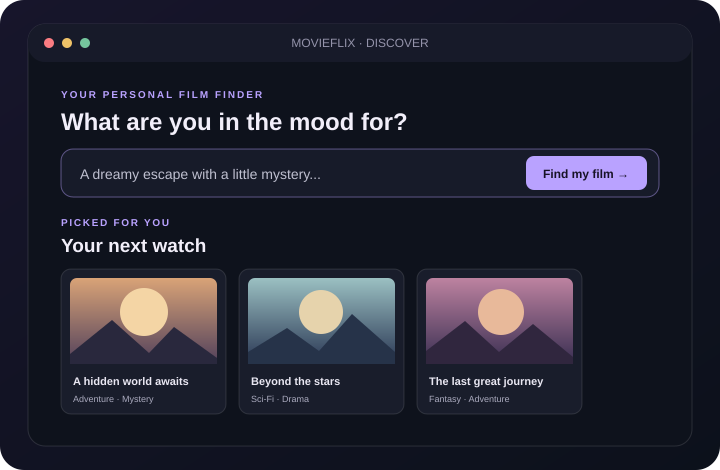
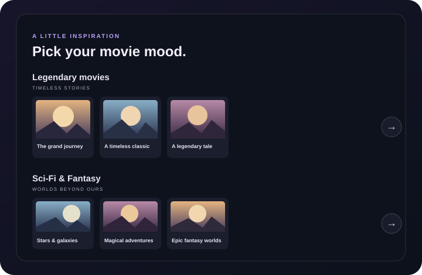

# MOVIEFLIX

<div align="center">
  
  <p><strong>Find the film you feel like watching.</strong><br />Discover movies by mood, explore similar stories, and browse curated genre sliders.</p>
</div>

## Discover MOVIEFLIX

MOVIEFLIX is a movie discovery app powered by a locally running semantic search model. Search by describing a mood or naming a movie, then explore recommendations and browse a catalog of films.

| Mood-based search | Curated movie sliders | Movie details & watchlist |
|:---:|:---:|:---:|
|  |  |  |

- **Find by feeling:** Describe a mood and get up to 15 recommendations.
- **Browse by genre:** Slide through Legendary, Superhero, Sci-Fi, and Fantasy picks, with up to 40 titles per shelf.
- **Explore and save:** Open movie details, find similar films, and keep a watchlist in your browser.
- **Pick a surprise:** Get a random pick from the movies currently shown in the collection.

## Getting started

The app uses the local `sentence-transformers/all-MiniLM-L6-v2` model. No Gemini API key is needed. The model downloads from Hugging Face on first run and is cached locally.

On Linux or macOS, create an environment and install CPU-only PyTorch followed by the app dependencies:

```sh
python3 -m venv .venv
source .venv/bin/activate
python -m pip install --upgrade pip
python -m pip install torch --index-url https://download.pytorch.org/whl/cpu
python -m pip install -r requirements.txt
python app.py
```

Open [http://127.0.0.1:8000](http://127.0.0.1:8000) in your browser. The first startup creates `.cache/movie_embeddings.json`; future startups reuse the cached embeddings. The cache refreshes when a movie profile changes or `EMBEDDING_MODEL` selects another model. Search queries are embedded locally too.

## Movie catalog and licensing

The catalog contains 1,000 feature films released between 1980 and 2026. Titles, years, genres, IMDb ratings, and vote counts are matched from IMDb's non-commercial datasets. Those datasets are licensed by IMDb for **non-commercial use only**. Review IMDb's current terms before using this catalog commercially.

Some plot introductions link to their corresponding Wikipedia articles; those summaries are available under the articles' Creative Commons Attribution-ShareAlike license. Movie posters are looked up from Wikimedia Commons; check the image's source and license information for attribution and permitted use.

## Project credits
Author - **Sumit Kumar**.
The frontend was developed with AI assistance.